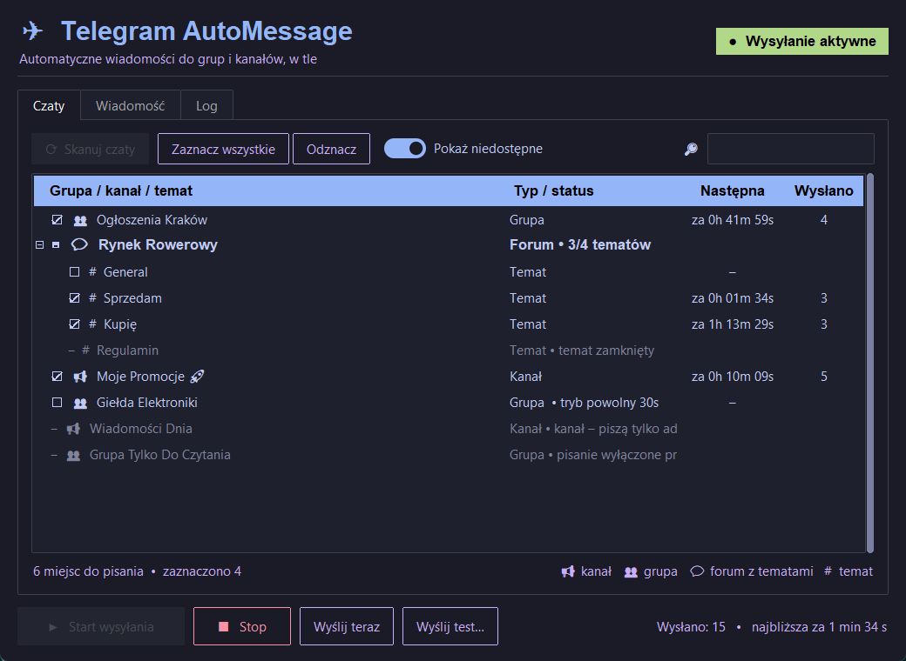
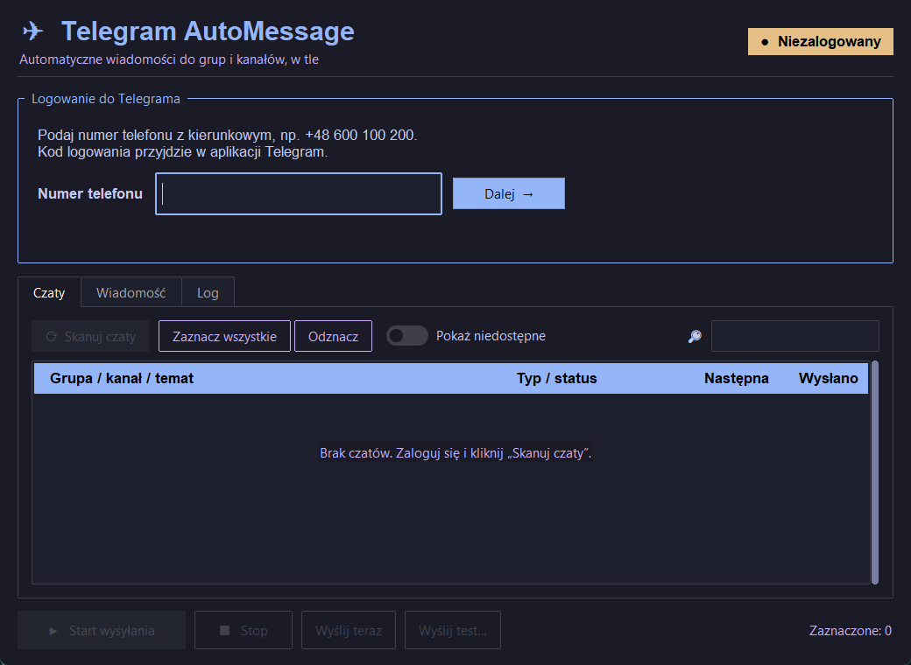
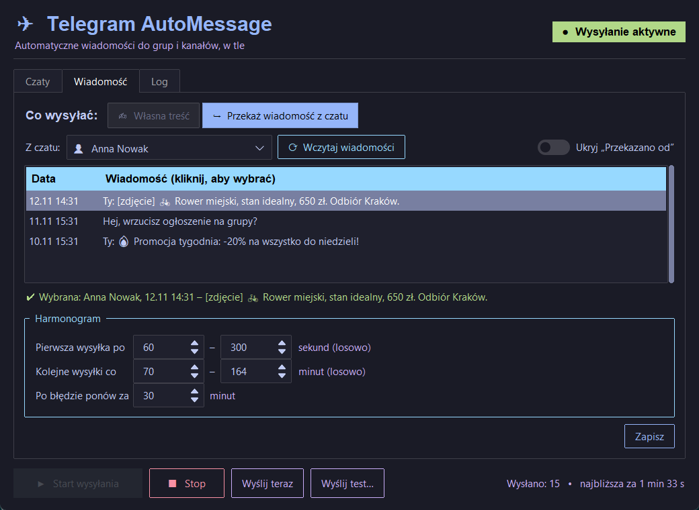
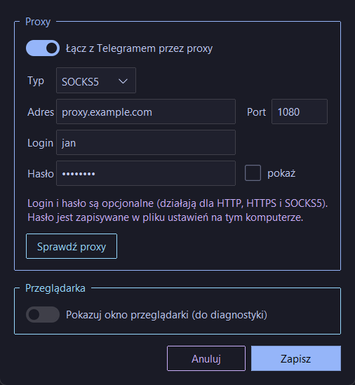

# ✈ Telegram AutoMessage

Program z okienkiem do automatycznego wysyłania wiadomości na grupy, kanały i tematy forum w Telegramie.
Działa w tle: przeglądarka jest niewidoczna, logujesz się numerem telefonu i kodem z aplikacji Telegram,
zaznaczasz czaty i ustawiasz, co ile minut ma iść wiadomość.

Działa na **Windows** i **Linux** (Debian, Ubuntu, Mint).



## Co potrafi

- **Logowanie bez kodu QR**: numer telefonu, kod z aplikacji Telegram i ewentualnie hasło 2FA wpisujesz w oknie programu. Sesja jest zapamiętywana.
- **Skanowanie czatów w sekundę**: program sam sprawdza, gdzie możesz pisać. Kanały, w których nie jesteś adminem, grupy z wyłączonym pisaniem i zamknięte tematy są pomijane, a obok widać powód.
- **Czytelna lista**: grupy 👥, kanały 📢 i fora 💬 z tematami `#` rozwiniętymi pod spodem. Kliknięcie forum zaznacza wszystkie jego tematy.
- **Dwa tryby wysyłki**:
  - ✍ **własna treść**: dowolny tekst, emoji i wiele linii;
  - ↪ **przekazanie wiadomości** z czatu prywatnego albo z „Zapisanych wiadomości”, także ze zdjęciem czy filmem. Opcjonalnie bez nagłówka „Przekazano od”.
- **Harmonogram**: każdy czat ma własny, losowy odstęp, np. co 70–164 min. Po błędzie program ponawia próbę później.
- **Tryb powolny (slow mode)**: program odczytuje limit grupy i wysyła zaraz po jego końcu. Nie traci 30 minut na ponowienie i nigdy nie wysyła częściej, niż grupa pozwala. Przy limicie konta (`FLOOD_WAIT`) wstrzymuje wysyłanie na czas podany przez Telegram.
- **Proxy**: HTTP, HTTPS, SOCKS5 i SOCKS4, także z loginem i hasłem. Ma przycisk do sprawdzenia, z jakim IP program jest widoczny w sieci.
- **Skanowanie nie oznacza czatów jako przeczytanych**: program nie otwiera czatów, tylko czyta dane z Telegram Web.
- **Motywy jasne i ciemne** w menu *Wygląd*.

| Logowanie | Przekazywanie wiadomości |
|---|---|
|  |  |

## Instalacja i uruchomienie

Pobierz projekt: zielony przycisk **Code → Download ZIP** i rozpakuj. Możesz też sklonować:

```bash
git clone https://github.com/Collector779/AutoMesage-Telegram-Selenium.git
```

### Windows

1. Zainstaluj [Python 3.10+](https://www.python.org/downloads/) i zaznacz w instalatorze **„Add python.exe to PATH”**.
2. Kliknij dwukrotnie **`run.bat`**.

Przy pierwszym uruchomieniu `run.bat` sam odpali `install.bat`. Ten zainstaluje biblioteki Pythona, a jeśli trzeba, także Google Chrome.

### Linux (Debian / Ubuntu / Mint)

```bash
cd AutoMesage-Telegram-Selenium
chmod +x run.sh install.sh
./run.sh
```

Przy pierwszym uruchomieniu `run.sh` odpali `install.sh` i zapyta o hasło do `sudo`. Instalator doinstaluje:

- Pythona z Tkinter i czcionki z emoji;
- przeglądarkę: na Debianie **Chromium** z `chromium-driver`, na Ubuntu i Mint **Google Chrome**;
- osobne środowisko Pythona w `.venv` z bibliotekami z `requirements.txt`;
- skrót **Telegram AutoMessage** w menu aplikacji.

Program potrzebuje pulpitu graficznego. Działa też w WSL2 na Windows 11 (WSLg).

### Ręcznie (dowolny system)

```bash
python -m pip install -r requirements.txt
python main.py
```

Potrzebny jest Google Chrome albo Chromium. Sterownik przeglądarki Selenium pobiera sam.

## Jak używać

1. **Zaloguj się**: wpisz numer z kierunkowym, np. `+48 600 100 200`, a potem kod, który przyjdzie w aplikacji Telegram. Jeśli masz hasło dwuetapowe, program o nie zapyta.
2. **Zakładka „Czaty”**: lista ładuje się sama po zalogowaniu. Zaznacz, gdzie wysyłać. Przycisk **„Pokaż niedostępne”** pokazuje także miejsca, w których nie możesz pisać, razem z powodem.
3. **Zakładka „Wiadomość”**:
   - wpisz własną treść **albo** wybierz **„Przekaż wiadomość z czatu”**;
   - przy przekazywaniu wybierz czat, kliknij **„Wczytaj wiadomości”** i zaznacz tę, którą chcesz wysyłać;
   - ustaw odstępy w sekcji *Harmonogram*.
4. **Sprawdź na jednym czacie**: kliknij czat na liście i użyj **„Wyślij test…”**.
5. Kliknij **▶ Start wysyłania**. W tabeli widać odliczanie do kolejnej wysyłki i licznik wysłanych. **■ Stop** zatrzymuje wysyłanie.

Menu **Konto → Wyloguj** usuwa zapisaną sesję.

## Proxy

**Plik → Ustawienia…** (albo `Ctrl+,`) lub kliknięcie wskaźnika proxy w nagłówku okna.



1. Włącz **„Łącz z Telegramem przez proxy”**.
2. Wybierz typ (**HTTP**, **HTTPS**, **SOCKS5** albo **SOCKS4**) i wpisz adres oraz port.
3. Jeśli proxy tego wymaga, wpisz login i hasło. Działa to dla HTTP, HTTPS i SOCKS5.
4. Kliknij **„Sprawdź proxy”**. Program połączy się przez proxy i pokaże IP, z jakim jest widoczny w sieci.
5. Kliknij **Zapisz**. Przeglądarka uruchomi się ponownie i cały ruch Telegrama pójdzie przez proxy.

Gdy proxy jest włączone, w nagłówku widać 🛡 adres proxy i aktualne IP.
**Narzędzia → Sprawdź IP przeglądarki** sprawdza je ponownie w każdej chwili.

Chrome sam nie umie logować się do proxy w tle ani do SOCKS5 z hasłem. Dlatego przy proxy z loginem program
uruchamia lokalny przekaźnik na `127.0.0.1`, który przekazuje ruch do Twojego proxy z danymi logowania.
Program wyłącza też WebRTC poza proxy, żeby przeglądarka nie zdradziła prawdziwego IP.

Uwaga: hasło do proxy jest zapisane w pliku ustawień na Twoim komputerze. Po zmianie IP Telegram może poprosić
o ponowne zalogowanie.

## Inne ustawienia

W **Plik → Ustawienia…** możesz też włączyć **„Pokazuj okno przeglądarki”**. Przeglądarka będzie wtedy widoczna,
co pomaga przy szukaniu problemów.

## Gdzie są dane

Ustawienia i sesja logowania są zapisywane poza folderem programu:

| System | Folder |
|---|---|
| Windows | `%APPDATA%\TelegramAutoMessage` |
| Linux | `~/.local/share/TelegramAutoMessage` |

Folder `chrome-profile` zawiera Twoją zalogowaną sesję Telegrama. **Nie udostępniaj go nikomu.**
Żeby całkiem zakończyć sesję, usuń też urządzenie w Telegramie: *Ustawienia → Urządzenia*.

## ⚠ Uwaga

Telegram ogranicza masowe wysyłanie wiadomości. Zbyt częste wysyłanie albo pisanie tam, gdzie nikt tego
nie chce, może skończyć się blokadą konta (spam ban). Ustawiaj rozsądne odstępy, szanuj regulaminy grup
i pisz tylko tam, gdzie wolno. Za sposób użycia odpowiadasz sam.

Program korzysta z wewnętrznych funkcji Telegram Web (`web.telegram.org/k`). Jeśli Telegram coś w nim zmieni,
program może wymagać aktualizacji.

## Problemy

| Objaw | Co zrobić |
|---|---|
| „Telegram Web nie odpowiada” | *Konto → Połącz ponownie*. Sprawdź internet. |
| Na Linuxie `No module named tkinter` | `sudo apt install python3-tk` albo uruchom ponownie `install.sh`. |
| Na Linuxie błąd sterownika Chromium | `sudo apt install chromium chromium-driver` (wersje muszą się zgadzać). |
| ⏳ przy czacie, w logu „Tryb powolny” | To nie błąd. Grupa ma tryb powolny, a program sam czeka do jego końca i wtedy wysyła. |
| ⏸ przy czatach, w logu „FLOOD_WAIT” | Telegram chwilowo ograniczył konto. Program wstrzymuje wszystkie wysyłki na podany czas. Rozważ dłuższe odstępy. |
| „Telegram Web nie wczytał się przez proxy” | W *Ustawieniach* kliknij **Sprawdź proxy**. Komunikat powie, czy problem jest w adresie, porcie czy haśle. |
| „proxy odrzuciło login lub hasło (407)” | Sprawdź login i hasło. Niektóre proxy zamiast hasła wymagają dodania Twojego IP do białej listy. |
| Coś innego | Zakładka **Log** pokazuje szczegóły. *Narzędzia → Zrzut ekranu przeglądarki* pokazuje, co widzi przeglądarka. |

## Pliki projektu

| Plik | Do czego służy |
|---|---|
| `main.py` | punkt startowy |
| `gui.py` | okno programu (ttkbootstrap) |
| `worker.py` | wątek w tle, który obsługuje przeglądarkę |
| `telegram_browser.py` | uruchamianie Chrome / Chromium w tle, ustawienia proxy |
| `proxy_relay.py` | lokalny przekaźnik proxy z logowaniem (HTTP / HTTPS / SOCKS5 / SOCKS4) |
| `telegram_login.py` | logowanie numerem i kodem |
| `telegram_api.py` | skanowanie, historia, wysyłanie i przekazywanie przez Telegram Web |
| `telegram_scheduler.py` | harmonogram wysyłek |
| `config.py` | ścieżki i ustawienia domyślne |
| `install.sh`, `run.sh` | instalacja i start na Linuxie |
| `install.bat`, `run.bat` | instalacja i start na Windows |
